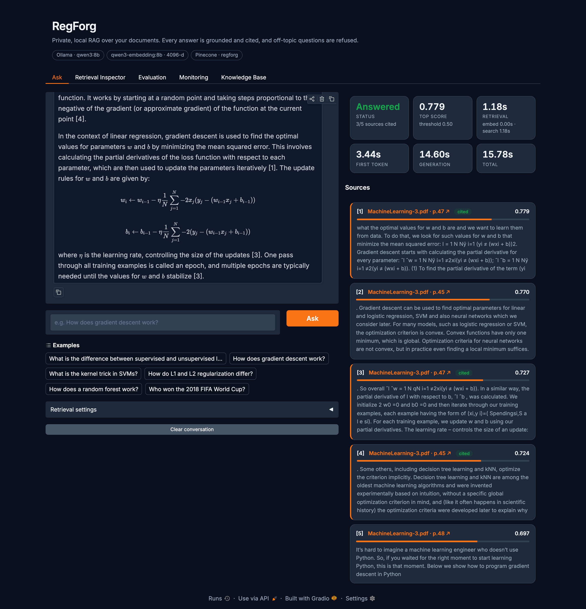
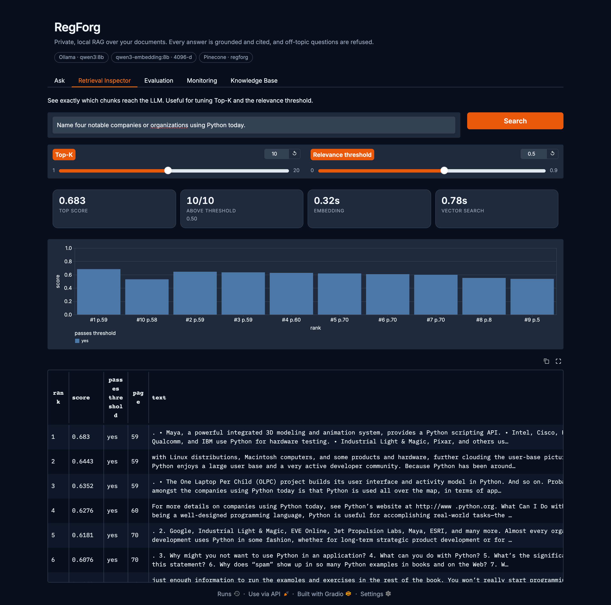
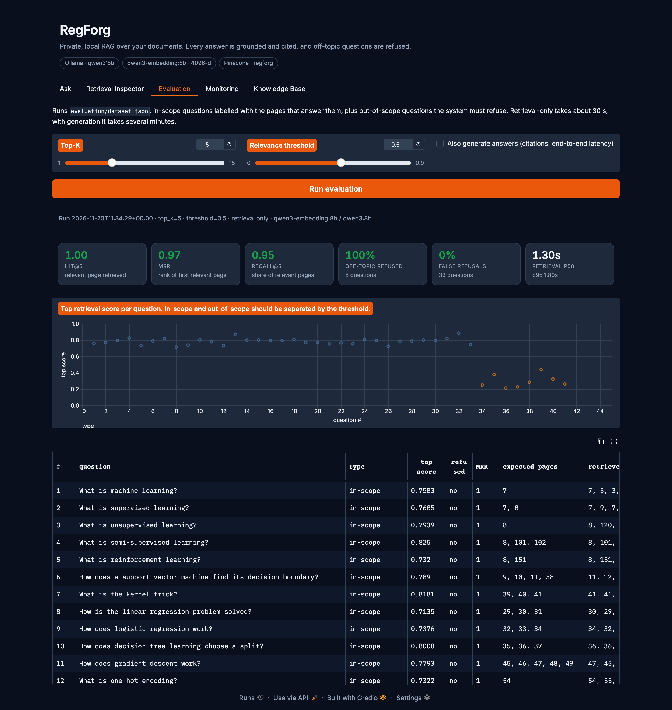
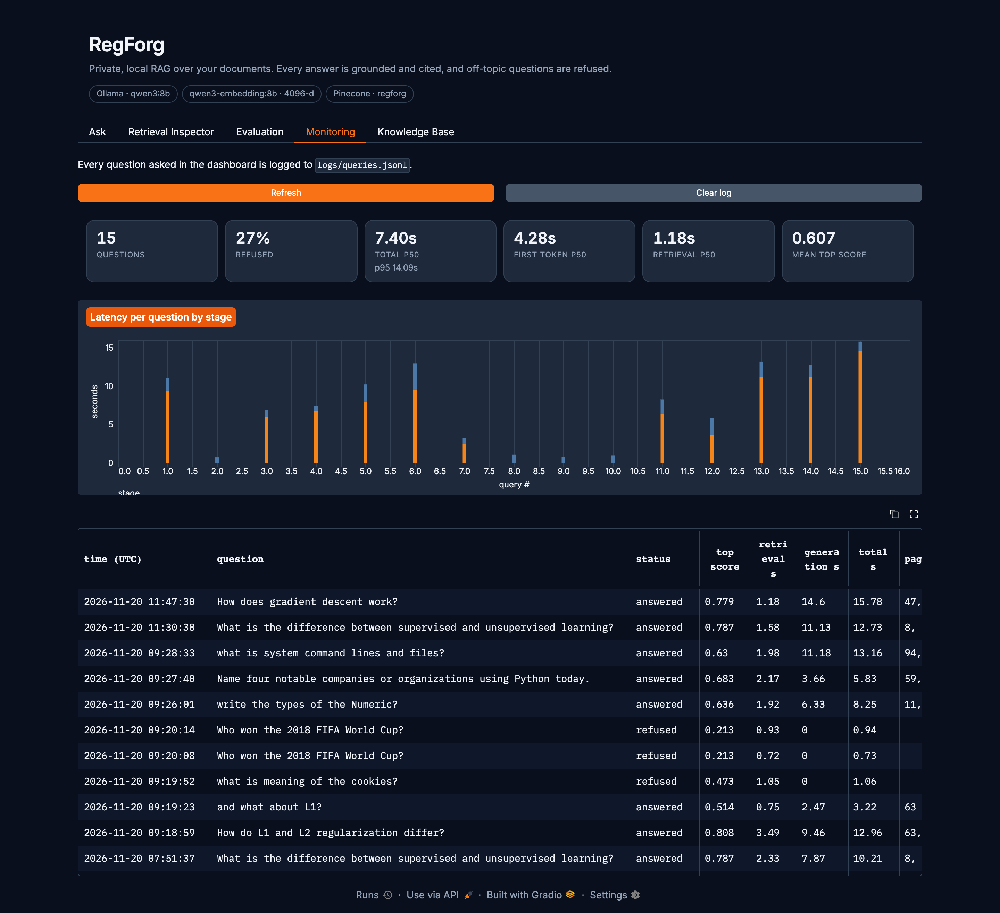
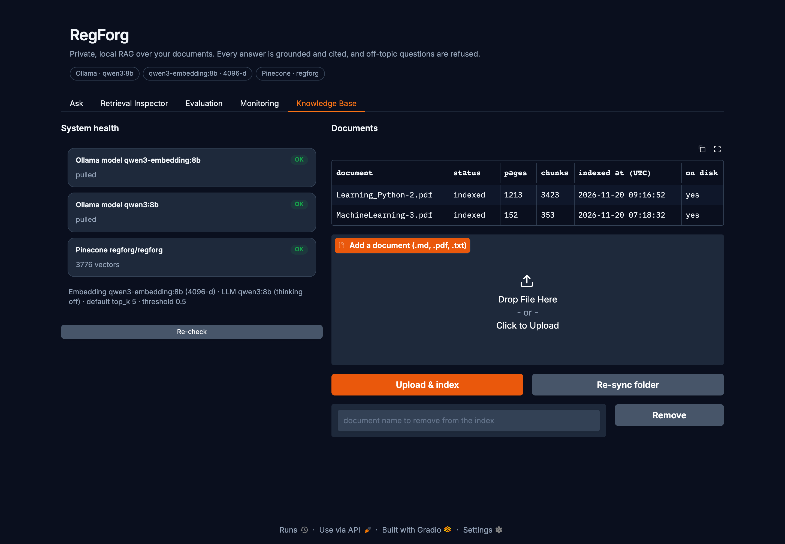
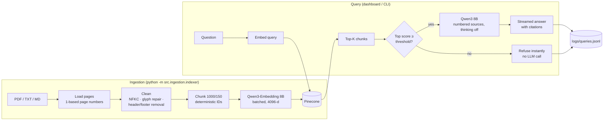

# RegForg

**A private, fully local RAG system with an interactive evaluation dashboard.**
Ask questions about your own PDFs: every answer is grounded in your documents, cited down to the page, and off-topic questions are refused instead of hallucinated.

`Ollama` · `Qwen3-Embedding 8B` · `Qwen3 8B` · `Pinecone` · `LangChain` · `Gradio 6`

---

## Demo

<!--
  VIDEO: drag-and-drop an .mp4 (≤10 MB) into this README while editing it on GitHub.
  GitHub uploads it and inserts a link like the one below; replace the placeholder with it.
-->

https://github.com/user-attachments/assets/REPLACE-WITH-YOUR-VIDEO-ID

<!--
  SCREENSHOTS: save PNGs into docs/images/ using these names, and they will appear below.
-->

| Ask: streaming, cited answers | Retrieval Inspector |
|---|---|
|  |  |
| **Evaluation** | **Monitoring** |
|  |  |



---

## Highlights

- **Runs locally.** Embeddings and generation run on your machine through Ollama; only vectors and chunk text are stored in Pinecone.
- **Cites its sources.** Answers reference `[1]`, `[2]`…, and each source card links to the exact PDF page.
- **Refuses what it can't answer.** A calibrated relevance gate refuses off-topic questions in under a second without calling the LLM.
- **Streams answers.** Tokens arrive as they are generated, and each stage's latency is shown per answer.
- **Measured quality.** An 82-question evaluation set covering two books (in-scope and out-of-scope) runs from the CLI or the dashboard.
- **Idempotent indexing.** Deterministic chunk IDs, so re-running never duplicates vectors and unchanged files are skipped.

## Indexed corpus

| Document | Pages | Chunks | Indexing time |
|---|---|---|---|
| *The Hundred-Page Machine Learning Book* (`MachineLearning-3.pdf`) | 152 | 353 | ≈ 5 min |
| *Learning Python* (`Learning_Python-2.pdf`) | 1,213 | 3,423 | ≈ 81 min |
| **Total** | **1,365** | **3,776 vectors** | |

Chunk counts are taken from `Data/index_manifest.json` and match the Pinecone index. Indexing time is for `qwen3-embedding:8b` on Apple Silicon.

## Results

### Both books (current index, 3,776 vectors)

82 questions: 74 in-scope questions (33 on the ML book, 41 on *Learning Python*), each labelled with its book and the pages that answer it, plus 8 out-of-scope questions. A retrieved chunk only counts as a hit if both the **book and the page** match. Retrieval only, `top_k=5`, threshold `0.50`.

| Metric | ML book (n=33) | Learning Python (n=41) | **All (n=74)** |
|---|---|---|---|
| Hit@5 | 1.00 | 1.00 | **1.00** |
| MRR | 0.97 | 0.80 | **0.88** |
| Recall@5 | 0.95 | 0.66 | **0.79** |
| In-scope questions wrongly refused | 0 % | 0 % | **0 %** |
| Out-of-scope questions refused | | | **100 % (8/8)** |

- **The threshold still has margin.** The lowest-scoring in-scope question scored 0.70, and the highest-scoring out-of-scope question scored 0.44. The 0.50 threshold was picked using the ML book, so the Python book is the first test it wasn't tuned on.
- **Learning Python has lower Recall@5 than the ML book.** That's expected. The book is 8× longer, and many topics run over 4–5 pages, but only 5 chunks are retrieved, so recall can't reach 1.0. Every question still has a correct page in the top 5.
- **Labels come from the book's structure, not the retriever.** The Learning Python pages come from the PDF's bookmark outline (section start → next section). They were checked against the indexed page numbers before running the evaluation.

### v1 → v2, ML book only

Evaluation on *The Hundred-Page Machine Learning Book* (152 pages, 353 chunks): 33 in-scope questions labelled with the pages that answer them, plus 8 out-of-scope questions.

| Metric | v1 | **v2 (this version)** |
|---|---|---|
| Hit@5 | 1.00 ¹ | **1.00** |
| MRR | 0.97 ¹ | **0.97** |
| Recall@5 | 0.93 ¹ | **0.95** |
| Out-of-scope questions refused | 0 % | **100 %** |
| In-scope questions wrongly refused | 0 % | **0 %** |
| Answers with a valid citation | — (no citations) | **100 %** |
| Retrieval latency, p50 | 4.4 s | **≈ 0.7 s** |
| Generation latency, same answer | ≈ 15 s | **≈ 2.3 s** |
| End-to-end, full cited answer, p50 | — | 9–11 s (first token ≈ 3 s, streamed) |

¹ v1's own 4-question set reported 1.00 on everything. These v1 numbers are from re-running v1's index on the 41-question ML set.

Latency was measured on Apple Silicon with 32 GB RAM, with Pinecone in `us-east-1`. Yours will differ.

The biggest wins came from fixing the process, not from swapping models: a relevance gate, turning off Qwen3's hidden "thinking" mode, caching clients instead of rebuilding them on every question, and cleaner chunks. See **[docs/PROJECT_ANALYSIS.md](docs/PROJECT_ANALYSIS.md)** for every gap found, the evidence, and the ideas that were tested and rejected.

---

## Architecture



## Dashboard

`python app.py` → <http://127.0.0.1:7860>

| Tab | What you can do |
|---|---|
| **Ask** | Chat with your documents. Answers stream in with `[n]` citations; cited sources are highlighted and link to the PDF page. Per-answer cards show status, top score, retrieval (embed + search), time to first token, generation and total time. Top-K and threshold can be tuned live. |
| **Retrieval Inspector** | See exactly which chunks come back for a query, their scores, and which pass the threshold, without calling the LLM. |
| **Evaluation** | Run the evaluation set with any Top-K and threshold, optionally including generation. Shows metric cards, a score chart separating in-scope from out-of-scope questions, and a per-question table. |
| **Monitoring** | Every question asked is logged: p50/p95 latency, refusal rate, latency by stage over time, and full history. |
| **Knowledge Base** | Health checks (Ollama, models, Pinecone), the indexed documents, upload and index a new file, re-sync the folder, or remove a document. |

---

## Quick start

### 1. Prerequisites

- Python 3.12
- [Ollama](https://ollama.com)
- A [Pinecone](https://www.pinecone.io) API key (the free tier is enough)

### 2. Install

```bash
git clone https://github.com/Ridham-Oza/RegForg.git
cd RegForg
python3 -m venv .venv
source .venv/bin/activate
pip install -r requirements.txt
```

### 3. Pull the models

```bash
ollama serve          # skip if the Ollama app is already running
ollama pull qwen3-embedding:8b
ollama pull qwen3:8b
```

### 4. Configure

```bash
cp .env.example .env
# set PINECONE_API_KEY in .env
```

### 5. Add documents and index them

```bash
cp ~/path/to/your.pdf Data/documents/
python -m src.ingestion.indexer           # creates the index on first run
```

Re-running only re-indexes files that changed. To start from scratch, run `python -m src.ingestion.indexer --rebuild`.

### 6. Launch the dashboard

```bash
python app.py
```

---

## Command line

| Command | Purpose |
|---|---|
| `python -m src.ingestion.chunker` | Preview chunking and detected boilerplate |
| `python -m src.ingestion.indexer [--rebuild]` | Index `Data/documents/` |
| `python -m src.retrieval.retriever` | Retrieval smoke test |
| `python -m src.pipeline.rag_pipeline "your question"` | Ask a question in the terminal (streams) |
| `python -m evaluation.evaluate [--generate] [--top-k 5] [--threshold 0.5]` | Run the evaluation |
| `pytest` | Run the 16 offline unit tests (no Ollama or Pinecone needed) |

## Evaluation

The evaluation set lives in [`evaluation/dataset.json`](evaluation/dataset.json). Relevant pages were labelled from the book's section headings, not from retriever output, so the evaluation does not grade itself.

| Metric | Meaning |
|---|---|
| **Hit@K** | A relevant page appears in the top K |
| **MRR** | 1 / rank of the first relevant page, averaged |
| **Recall@K** | Share of the relevant pages that were retrieved |
| **Out-of-scope refused** | Off-topic questions correctly refused |
| **False refusals** | In-scope questions wrongly refused |
| **Citation rate** | Answered questions whose answer cites a valid source (`--generate`) |
| **p50 / p95 latency** | Retrieval, generation and end-to-end, per question |

Removed from v1: *average similarity* (depends on the model, not on quality), *end-to-end retrieval latency* (measured the same span as retrieval latency), and *chunks used* (always equal to K).

To evaluate your own documents, replace the items in `dataset.json` with your questions and the 1-based pages that answer them.

## Configuration

Every setting can be overridden in `.env` (see [`.env.example`](.env.example)).

| Variable | Default | Notes |
|---|---|---|
| `PINECONE_API_KEY` | — | required |
| `PINECONE_INDEX_NAME` / `PINECONE_NAMESPACE` | `regforg` / `regforg` | |
| `EMBEDDING_MODEL` | `qwen3-embedding:8b` | 4096-d; change `PINECONE_DIMENSION` if you switch models |
| `LLM_MODEL` | `qwen3:8b` | any Ollama chat model |
| `LLM_THINKING` | `false` | `true` re-enables Qwen3 reasoning (~6× slower) |
| `TOP_K` | `5` | chunks retrieved per question |
| `RELEVANCE_THRESHOLD` | `0.50` | refuse when no chunk scores above this; tune it in the Evaluation tab |
| `CHUNK_SIZE` / `CHUNK_OVERLAP` | `1000` / `150` | characters; re-index after changing |
| `OLLAMA_KEEP_ALIVE_SECONDS` | `1800` | keeps models loaded between questions |
| `GRADIO_SERVER_PORT` | `7860` | |

## Project structure

```text
RegForg/
├── app.py                        # dashboard entry point
├── config.py                     # all settings (read from .env)
├── requirements.txt
├── .env.example
├── Data/documents/               # your documents (git-ignored)
├── src/
│   ├── ingestion/
│   │   ├── loader.py             # PDF/TXT/MD → pages
│   │   ├── chunker.py            # cleaning, chunking, deterministic IDs
│   │   └── indexer.py            # idempotent Pinecone sync
│   ├── embeddings/ollama_embeddings.py
│   ├── retrieval/retriever.py    # dense retrieval + relevance gate
│   ├── generation/llm.py         # cited, streamed answers
│   ├── pipeline/rag_pipeline.py  # the one pipeline used everywhere
│   ├── dashboard/app.py          # Gradio dashboard (5 tabs)
│   └── utils/                    # logger, query log
├── evaluation/
│   ├── dataset.json              # 82 labelled questions, two books
│   ├── metrics.py
│   ├── evaluate.py
│   └── results/latest.json       # last run, shown in the dashboard
├── tests/                        # offline unit tests
└── docs/
    ├── PROJECT_ANALYSIS.md       # gap analysis and design decisions
    └── images/                   # screenshots for this README
```

## Troubleshooting

| Symptom | Fix |
|---|---|
| `Ollama server not reachable` in Knowledge Base | Run `ollama serve`, or start the Ollama app |
| `model … not found` | `ollama pull qwen3-embedding:8b && ollama pull qwen3:8b` |
| `Embedding dimension … does not match` | Set `PINECONE_DIMENSION` to your embedding model's size and use a new index name |
| Good questions get refused | Lower `RELEVANCE_THRESHOLD`; use the Retrieval Inspector to see the scores |
| Off-topic questions get answered | Raise `RELEVANCE_THRESHOLD` |
| First answer after a pause is slow | The model is reloading; increase `OLLAMA_KEEP_ALIVE_SECONDS` |
| Port 7860 in use | `GRADIO_SERVER_PORT=7861 python app.py` |

## Limitations and roadmap

- Single-turn: follow-up questions are not rewritten using chat history yet.
- The two-book results are retrieval-only. Citation rate and generation latency (`--generate`) have only been measured on the ML book.
- The 0.50 threshold was tuned on the same ML questions it is scored on. The Learning Python questions are the first held-out check, and a dedicated held-out split is still to do.
- Citations are checked for validity, not for whether the cited chunk supports each sentence (an LLM-as-judge faithfulness check is a natural next step).
- Hybrid BM25 + dense search was evaluated and not needed for this corpus (dense Hit@5 = 1.00). It is worth revisiting for larger, multi-document collections.

## Author

**Ridham Oza** — AI / ML · Generative AI · RAG · LLM applications

Licensed under the [MIT License](LICENSE).
